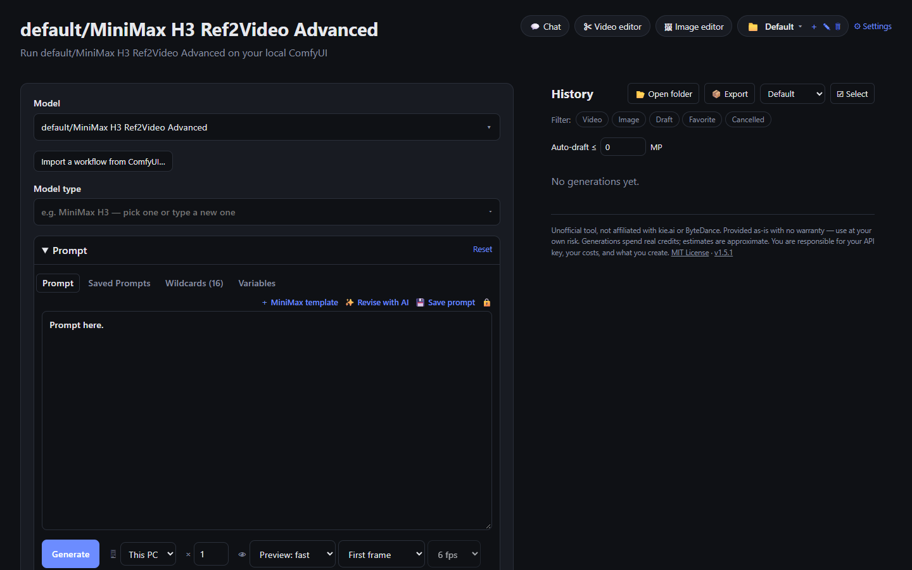
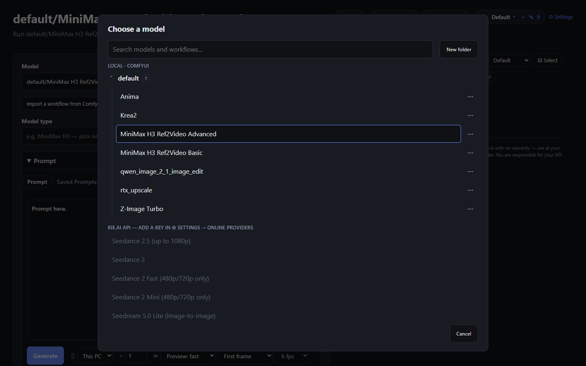
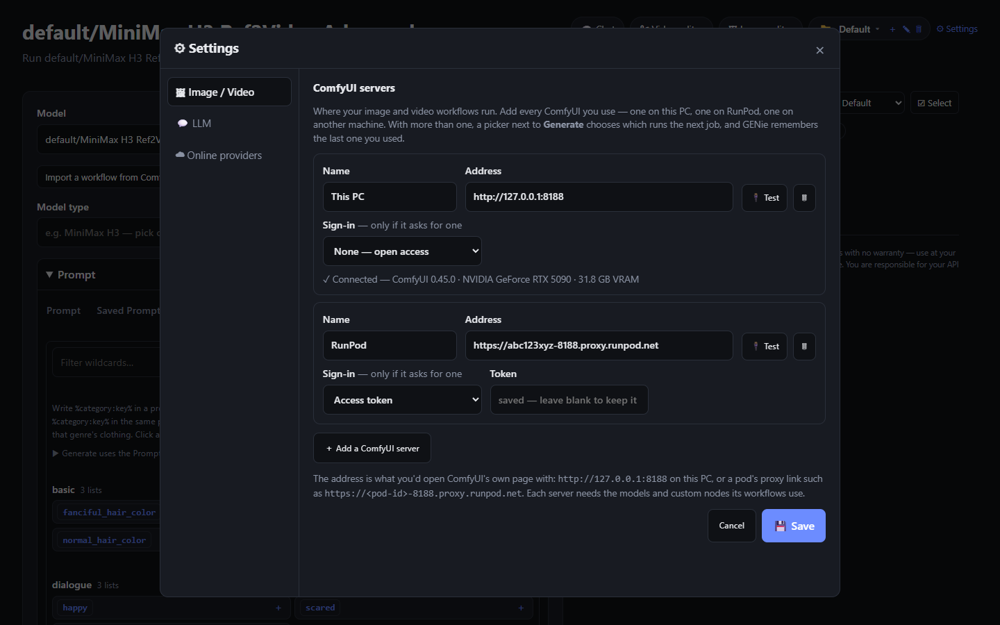
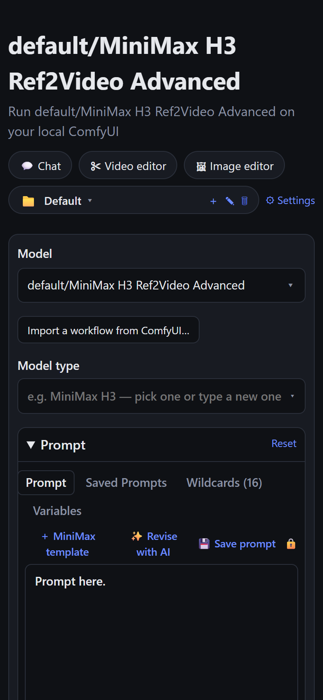
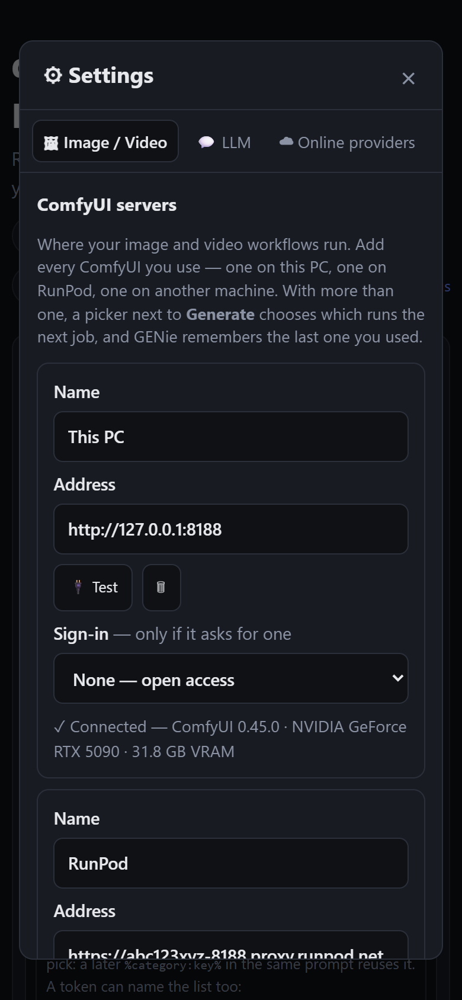

<p align="center">
  
</p>

# GENie

*Your wish, rendered.* A small local web app that is a **friendly front-end for your own
ComfyUI**, a **project manager** for everything you generate, and a **prompt workshop**
with an LLM at your elbow — plus, optionally, a client for **cloud models** through
[kie.ai](https://kie.ai). One page does it all: pick a workflow (or a cloud model) and
the form adapts to it.



- **No workflow authoring.** Import a workflow straight from ComfyUI (or drop an API
  export into `workflows/`) and GENie builds a form from the nodes it recognizes.
- **No config files.** `npm install`, `npm start`, open the page. ComfyUI servers, LLM
  servers and API keys are all set up in the app, under **⚙ Settings**.
- **Everything stays on your disk**, filed by project: prompts, references, results.
- **Works on your phone.** The whole app is mobile-friendly — see
  [Desktop and phone](#desktop-and-phone).

> **What's new:** see the [changelog](CHANGELOG.md). The running version is shown in the
> page footer.

## Contents

- [Features](#features) — [ComfyUI front-end](#local-comfyui-front-end) ·
  [Prompts](#prompts) · [LLM help](#llm-help) · [Projects, History and Gallery](#projects-history-and-gallery) ·
  [Editors](#editors) · [Settings](#settings) · [kie.ai cloud](#kieai-cloud-optional)
- [Desktop and phone](#desktop-and-phone)
- [Setup](#setup)

## Features

### Local ComfyUI front-end

- **Zero-authoring workflows** — **Import a workflow from ComfyUI…** copies one you've
  saved in ComfyUI's editor (converted to API format for you), or drop a raw
  **File → Export (API)** `.json` into `workflows/`. GENie recognizes its nodes and
  builds the form automatically, each recognized node a collapsible section; nodes it
  doesn't recognize run exactly as saved. See [`docs/COMFYUI.md`](docs/COMFYUI.md).
- **Searchable Model picker** — workflows are laid out as a folder tree you can search,
  with the cloud models beneath. Create folders and rename, move, copy or delete
  workflows from the picker itself.

  

- **Several ComfyUI servers** — add every ComfyUI you use (this PC, a RunPod pod, another
  machine) in ⚙ Settings; a picker next to **Generate** chooses which one runs the job.
- **Live model options** — dropdowns for models, LoRAs, VAEs and samplers fill from the
  running ComfyUI, and number fields pick up their real min/max/step, so you choose from
  exactly what's installed.
- **LoRAs** — add extra LoRAs to any workflow, edit the ones it already has, keep notes
  on each (name, description, URL, trigger phrases), and browse them by **model type**.
- **Optional nodes** — flip `_meta.bypassable` "patch" nodes on and off without editing
  the graph.
- **Live previews & host stats** — a run's card shows the frame forming as it samples
  (or, for video, the clip looping), with a CPU / GPU / VRAM strip and a **Free VRAM**
  button.
- **Queue control** — queue several runs with **×N**, cancel one, or **Cancel all
  queued**. Runs finish server-side, so closing the tab (or the phone going to sleep)
  loses nothing.
- **Continue** — workflows that carry state between runs get a Continue button, so a
  second clip picks up where the first left off.
- **Extensible by data, not code** — supporting a new node type is a small JSON file in
  [`node_types/`](node_types/); no server changes.

### Prompts

- **Saved Prompts** — save a prompt with its reference media, per project or 🌐 global,
  and generate straight from the card. **Prompt groups** string saved prompts into a
  sequence for longer videos.
- **Structured prompt formats** — besides plain text, a MiniMax H3 editor with
  subjects, shots (each with a length, re-orderable), retention and sound, for
  reference-to-video and text-to-video.
- **Wildcards and Variables** — named lists a prompt picks from at random, and named
  blocks of text you write once and reuse (`$name`), global or per project.
- **Prompt lock (🔒)** — keep the prompt and references when switching models.

### LLM help

Works with **LM Studio**, **text-generation-webui**, **Ollama**, a **llama.cpp server**
GENie starts itself, any **OpenAI-compatible** server, or **kie.ai**'s chat models
(Claude, GPT, Gemini…). See [`docs/LLM.md`](docs/LLM.md).

- **✨ Build with AI** — a vision model looks at the images you pick and writes a shot
  list from a short description; you edit the shots, and it writes the rest of each
  prompt around them.
- **✨ Revise with AI** — say what to change in a prompt and get it rewritten, following
  the prompting guide for the model you're on (Seedance, Kling, MiniMax, Qwen Edit).
  Each project keeps a history of its revisions: the prompt before, what you asked, and
  the result.
- **✨ Analyze images** — fills in a subject's definition from its reference images.
- **💬 Chat** — talk to the same LLM, with pictures; chats are kept on the server.
- **Shares the GPU politely** — a local LLM loads only when ComfyUI is idle and there's
  VRAM for it, and unloads the moment a generation starts. A CPU-only or cloud LLM runs
  alongside.

### Projects, History and Gallery

- **Projects** — every generation, local or cloud, lands in a project with its own
  gallery, history and output folder. Projects can be filed in folders.
- **History** — each run is saved with its prompt, settings and references. **Re-import**
  loads it back into the form, **Re-run** generates it again; filter by tag (video /
  image / draft / favorite, per-workflow auto-tags, and tags of your own — per project
  or global), jot a note on any card, select many to move them, and
  **📦 Export** a project as a self-contained folder you can zip and share.
- **Gallery** — every reference file you drop (or paste with Ctrl+V) is kept per
  project, with an optional subject key and definition, ready to click back into a run.
- **Drag-and-drop references** — images, video and audio each have a dropzone;
  thumbnails are labeled and re-orderable, and the labels in your prompt follow.

### Editors

- **✂ Video editor** — trim, cut, split, join and re-order clips, pick stills (**⇥ Last
  frame** to start the next clip from), add PNG overlays, adjust colour and resize.
  Frame-accurate, never overwrites a source. Needs [ffmpeg](docs/FFMPEG.md).
- **🖼 Image editor** — crop, flip, draw, and paint masks, with pinch-zoom.

### Settings

**⚙ Settings** (top right) is one window with a tab per section — nothing to edit by
hand, and every device that opens GENie shares the same settings.



- **Image / Video** — your ComfyUI servers: a name, an address and a **Test** button
  each, plus an optional sign-in (access token, or username and password) for one that's
  behind a login.
- **LLM** — the LLM servers and how they share the GPU with ComfyUI.
- **Online providers** — API keys for cloud services. kie.ai's key is entered once and
  covers both its image/video models and its chat models.

### kie.ai cloud (optional)

Add a kie.ai key (⚙ Settings → Online providers) and the cloud models switch on in the
Model picker; skip it and GENie is a pure ComfyUI front-end.

- **Models** — **Seedance 2.5 / 2 / 2 Fast / 2 Mini**, **Kling 4.0** (reference-to-video
  and keyframe-to-video), **MiniMax H3 / Hailuo 03** (text-, image- and
  reference-to-video), **Wan 3.0 / 3.0 Prime**, and **Seedream 5.0** (image-to-image and
  text-to-image). The form adapts to each. Local copies of the model docs live in
  [`docs/kie-api/`](docs/kie-api/README.md).
- **Reference hosting** — dropped files are saved locally and uploaded to kie.ai only at
  generate time, so its short-lived URLs never matter; re-runs re-host automatically.
- **Batches** — **×N** queues up to 20 identical runs; references upload once.
- **Credits and cost** — the live balance sits in the header, each run's measured cost
  is stored in History, and the estimate beside Generate learns from your own runs.
- **Your key stays server-side** — the browser only ever talks to your local GENie.

## Desktop and phone

GENie is laid out for a desktop browser first — from 1200px wide the form and History
sit side by side — and the same page reflows for a phone: every feature works there,
including the editors, the prompt tools, live previews and Settings. Runs are tracked by
the server, not the tab, so you can queue from the PC and watch (or queue more) from the
couch.

<p align="center">
  
  &nbsp;&nbsp;
  
</p>

To reach it from your phone, see
[Accessing from other devices on your home network](#accessing-from-other-devices-on-your-home-network).

## Setup

> **New to git, Node, or the terminal?** Follow the step-by-step
> [beginner's install guide](INSTALL.md) instead — no prior knowledge needed.

You'll need [Node.js](https://nodejs.org) 18+ (uses the built-in `fetch`).

```bash
# 1. Install dependencies
npm install

# 2. Run it
npm start
```

Open <http://localhost:3000> in your browser. There's no config file to edit first:
your ComfyUI servers, LLM servers and the kie.ai key are all set up in the app, under
**⚙ Settings** (top right). A `.env` file is only for the optional extras in
`.env.example` — port, LAN access, a password, custom folders.

For auto-restart while developing: `npm run dev`.

**Optional: [install ffmpeg](docs/FFMPEG.md)** (Windows: `winget install Gyan.FFmpeg`,
macOS: `brew install ffmpeg`, Debian/Ubuntu: `sudo apt install ffmpeg`) for the
✂ Video editor's cutting and saving, and for exact frame rates. Everything else works
without it.

To run **local ComfyUI workflows**, GENie looks for ComfyUI at `http://127.0.0.1:8188`.
Somewhere else, or more than one (this PC and a RunPod pod, say)? Add them in
**⚙ Settings → Image / Video**; with several, a picker next to **Generate** chooses
which one runs the job. See [`docs/COMFYUI.md`](docs/COMFYUI.md). No API key needed for
local workflows.

## Getting an API key (for cloud models)

The kie.ai key is only needed for the **cloud** models — local ComfyUI workflows don't
use it. To enable the cloud models:

1. Go to <https://kie.ai/api-key> and create a key
2. In GENie, open **⚙ Settings → Online providers**, paste it under kie.ai and **Save**

The same key also lets you add kie.ai's chat models as an LLM server (**⚙ Settings →
LLM → ＋ Add… → kie.ai**).

**Each person running the app needs their own key**, and cloud generations are billed
to the key's account.

## Updating to a newer version (complete beginner)

> ⚠️ **One-time step if you have data from before the folder rename.** The data
> folders were renamed `video → output` and `images → input`. If your copy still
> has old `video/` / `images/` folders after updating, stop the app and run this
> once to move them and fix your saved history/gallery links (it backs up the JSON
> first, and is safe to re-run):
>
> ```
> node migrate-folders.cjs
> ```

New features and fixes land over time. How you update depends on how you first
**got** the app. Not sure which you did? If your app folder contains a hidden
`.git` folder, you cloned it — use the git steps. If you downloaded and unzipped
a file, use the ZIP steps.

Whichever method you use, your personal stuff is always kept:

- **`.env`** and the **`settings` folder** — your password and options, your ComfyUI /
  LLM servers and your API key
- **`history.json`, `images.json`, `projects.json`** — your generation history,
  gallery, and projects
- **the `output`, `input` and `projects` folders** — your generated results,
  reference media, and each project's saved prompts

> 💡 Five-second safety net: before updating, make a copy of your whole app
> folder (right-click → Copy, then Paste) so you can fall back to it if anything
> goes wrong.

### If you downloaded the ZIP

You're not using git, so you re-download and carry your personal files across:

1. On the project's GitHub page, click the green **`<> Code`** button →
   **Download ZIP**, and unzip it into a **new** folder (don't overwrite the old
   one yet).
2. From your **old** app folder, copy these into the **new** folder, replacing
   what's there when asked:
   - the file `.env`
   - any of `history.json`, `images.json`, `projects.json` that exist
   - the `output`, `input` and `projects` folders

   *(These files are hidden from GitHub on purpose, so the new download won't
   contain them — that's why you copy your own across.)*
3. Open a terminal in the **new** folder (see the
   [install guide](INSTALL.md#step-3--open-a-terminal-in-the-project-folder) if
   you're unsure how) and run:

   ```
   npm install
   ```

4. Start it as usual with `npm start`. Once you've confirmed the new folder
   works, you can delete the old one.

### If you cloned with git

Your personal files are ignored by git, so they're left untouched — updating is
two commands. Open a terminal in the app folder and run:

```
git pull
npm install
```

Then start it again with `npm start`.

- `git pull` downloads the latest code. `npm install` picks up any new libraries
  (safe to run even when there are none).
- If `git pull` prints something about **"local changes"** that would be
  overwritten, it means you edited a tracked file. If you didn't change anything
  on purpose, run `git stash` first, then `git pull` again. If you're stuck,
  the ZIP method above always works as a fallback.

## Security / sharing notes

- **Never commit `.env`.** It holds your secret API key and is listed in
  `.gitignore`. Only `.env.example` (a key-less template) is tracked.
- If you deploy this somewhere public, anyone who can reach the URL can spend your
  API credits, since the key lives on the server. Keep it local or behind auth.

## Accessing from other devices on your home network

By default the server listens on `127.0.0.1`, so only the PC it runs on can reach
it. To open it to your phone/laptop on the same Wi-Fi:

1. Set `HOST=0.0.0.0` in `.env` and restart (`npm start`).
2. The startup message prints the URL(s) to use, e.g. `http://192.168.1.50:3000`.
   Enter that on the other device's browser.
3. On Windows you may get a one-time "Allow Node.js through the firewall" prompt —
   allow it for **Private** networks only.

By default there is **no login**, so anyone on your network who opens that URL can
use the app and spend your kie.ai credits. Set a password (below) if you enable
LAN access. Either way, only enable it on a network you trust, and **never**
port-forward it or otherwise expose it to the public internet.

## Password protection (optional)

Set `APP_PASSWORD` in `.env` and restart to require a password before the app can
be used:

```
APP_PASSWORD=your-shared-password
```

When set, every page, API call, and saved media file requires signing in first —
a simple password page appears until you enter it. The sign-in is remembered in a
cookie for 30 days per browser. Leave `APP_PASSWORD` blank/unset for no login
(the default). Recommended whenever you turn on LAN access. Note this is a single
shared password meant for a trusted home network, not per-user accounts.

## How it works

| Endpoint | What it does |
| --- | --- |
| `POST /api/create` | Builds the `bytedance/seedance-2` payload and calls `createTask`. |
| `GET /api/status?taskId=...` | Proxies `recordInfo` so the UI can poll for the result. |
| `GET /api/credits` | Proxies the account credit balance. |
| `GET/POST /api/projects`, `PUT/DELETE /api/projects/:id` | Project CRUD; delete moves contents to Default. |
| `POST /api/upload` | Saves dropped media (image/video/audio) to `input/` locally — no API call. |
| `POST /api/reupload` | Hosts a saved local file (by id) on kie.ai at generate time; returns a fresh URL. |
| `GET /api/images` | Lists the saved media gallery. |
| `DELETE /api/images/:id` | Removes an item from the gallery. |
| `POST /api/save` | Downloads the finished video into `output/` and appends the record (incl. measured cost) to `history.json`. |
| `GET /api/history` | Returns the saved generation history. |

The browser never sees your kie.ai key — it only talks to this local server.

## Project layout

```
server.js          Express proxy (holds the API key)
public/index.html  UI
public/style.css   styling
public/app.js      form handling, image upload, polling, history
public/llm.js      ✨ Build with AI dialog and LLM settings
llm.js             LLM sources, GPU turn-taking with ComfyUI, prompt-build jobs
public/video-editor.js  ✂ Video editor dialog
video-editor.js    the video editor's uploads, ffmpeg export jobs (with effects) and download
public/video-fx.js the video editor's 🎨 Effects form and live preview
.env.example       template for the optional .env (port, LAN access, password, folders)
output/<project>/   downloaded result videos (git-ignored, created at runtime)
output/<project>/edited_videos/  what the ✂ Video editor's Save button writes
output/<project>/edited_videos/overlays/  images added as 🎨 overlay layers
input/<project>/  saved reference media — images/video/audio (git-ignored, created at runtime)
exports/<name>/    shareable history bundles from the Export button (git-ignored, created at runtime)
history.json       generation history (git-ignored, created at runtime)
images.json        saved-media gallery manifest (git-ignored, created at runtime)
projects.json      project list (git-ignored, created at runtime)
projects/<project>/prompts.json  the project's saved prompts (git-ignored, created at runtime)
settings/llm.json  LLM servers, keys and options (git-ignored, created at runtime)
```

The `output/` and `input/` locations can be moved off the app folder by setting
`OUTPUT_DIR` and/or `INPUT_DIR` in `.env` (absolute path, or relative to the app
folder). The per-project subfolders are still created inside whatever you choose.

## License & Disclaimer

This project is licensed under the [MIT License](LICENSE). In plain English:

**This software is provided "as is", without warranty of any kind, and you use
it entirely at your own risk.** By downloading or running it you accept that
the author is **not responsible or liable** for:

- any damage to your computer, files, or data;
- any charges, credit consumption, or costs incurred on your kie.ai account
  (every generation spends real credits — the cost estimates shown in the app
  are approximations, not guarantees);
- anything you create, generate, publish, or otherwise do with this software
  or its outputs — that's on you, including complying with kie.ai's and
  ByteDance's terms of service and the laws that apply to you;
- the safekeeping of your API key. Your key is stored in a local file
  (`settings/generation.json`) and sent only to kie.ai. If you commit it, share it, screenshot it, paste it
  somewhere public, or otherwise leak it, anyone who has it can spend your
  credits. Guard it accordingly.

This is an unofficial hobby tool. It is **not affiliated with, endorsed by, or
supported by kie.ai, ByteDance, ComfyUI, or any other corporation or organization**.
Their APIs, models, pricing, and terms can
change at any time and break this app without notice.
